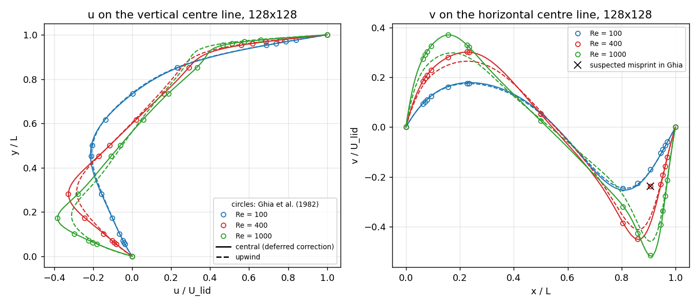
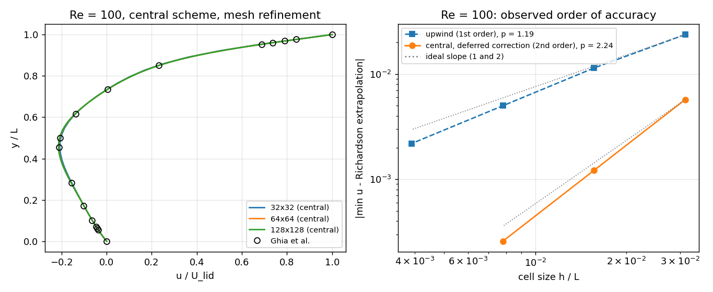
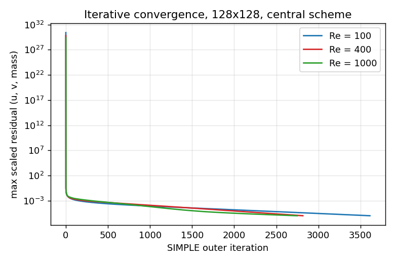
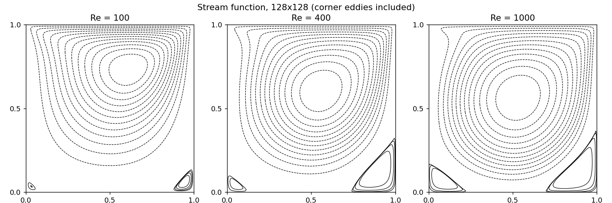
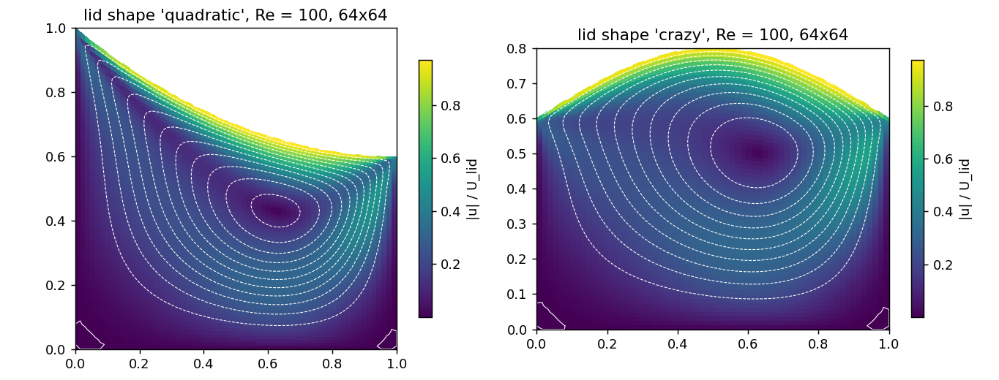

# collocated-simple-fvm

A 2-D incompressible Navier–Stokes solver written from scratch in Python: finite volumes on a
collocated grid, SIMPLE pressure–velocity coupling with Rhie–Chow interpolation, line-by-line
TDMA and a sparse direct pressure solve. It runs on structured meshes that follow a curved
top wall, and is checked on the lid-driven cavity against the numerical benchmark of
Ghia, Ghia & Shin (1982) at Re = 100, 400 and 1000.



## Results at a glance

RMS deviation of the centre-line velocities from Ghia et al. (1982), 128 x 128 cells:

| Re | upwind convection (u / v) | central convection, deferred correction (u / v) |
|---:|:---:|:---:|
| 100 | 0.0026 / 0.0034 | 0.0022 / 0.0046 |
| 400 | 0.020 / 0.024 | **0.0011 / 0.0024** |
| 1000 | 0.037 / 0.045 | **0.0020 / 0.0060** |

- Every case converges to a scaled residual of 1e-6 in u, v and mass.
- Mass is conserved in every cell to round-off (largest cell imbalance below 2e-17 of the lid mass flux).
- Grid convergence at Re = 100 (minimum u on the vertical centre line): observed order **2.24**
  with the central scheme (32/64/128 cells, Grid Convergence Index 0.15 % on the fine mesh) and
  **1.19** with upwind (64/128/256 cells, GCI 1.3 %). Both are the expected orders. Full table:
  [`results/gci_re100.json`](results/gci_re100.json).
- Cost: one SIMPLE iteration on 128 x 128 cells takes about 0.08 s on a laptop CPU. The Re = 1000
  case converges in about 2 700 iterations (6 minutes).

| | |
|---|---|
|  |  |
|  |  |

## Method

| Part | Choice |
|---|---|
| Arrangement | Collocated, cell-centred, one ghost layer on the wall face centres |
| Mesh | Structured; vertical grid lines, each divided evenly up to a curved lid (`linear`, `quadratic`, `crazy` or `rectangular`) |
| Convection | First-order upwind in the matrix; optional central differencing by deferred correction (`gamma_dc = 1`) |
| Diffusion | Central, orthogonal part (`Gamma |S| / |d|`) |
| Gradients | Gauss theorem over the four faces |
| Coupling | SIMPLE, Rhie–Chow face velocities along the face normal; corrected face mass fluxes are stored and reused by the momentum equations, so every cell is conservative |
| Pressure correction | Zero-gradient on all walls, one cell pinned; solved with SciPy sparse LU (or TDMA) |
| Momentum solve | Vectorised alternating-direction TDMA, two sweeps per outer iteration |
| Relaxation | `alpha_u = 0.7`, `alpha_p = 0.3` |

## Quick start

```bash
pip install -r requirements.txt
python examples/quickstart.py          # Re = 100 on 64 x 64, compared with Ghia
python -m pytest -q                    # verification tests
python scripts/run_vv.py               # validation set, upwind
python scripts/run_vv.py --dc          # validation set, central (deferred correction)
python scripts/make_figures.py         # figures in docs/figures, tables in results/
```

```python
from simplefvm import SimpleSolver, ghia

s = SimpleSolver(M=128, Re=1000, gamma_dc=1.0)     # square cavity, central convection
s.run(tol=1e-6)
print(ghia.compare(s, 1000))                       # RMS / max deviation on the centre lines

c = SimpleSolver(M=64, Re=100, H1=2.0, H2=1.2, shape="quadratic",   # curved lid
                 alpha_u=0.5, alpha_p=0.2)
c.run()
```

## Verification and numerical benchmarks

**Code verification** ([`tests/test_solver.py`](tests/test_solver.py))
- Cell geometry is closed: the face normal vectors of every cell sum to zero, and the cell areas
  sum to the domain area, on all four lid shapes.
- The Gauss gradient is exact for a linear field.
- The vectorised TDMA and the sparse direct solver give the same solution of a Poisson problem.
- Mass is conserved per cell after convergence, on the square and the curved cavity.
- The central scheme is more accurate than upwind on the same mesh, and both meet a tolerance
  against Ghia at Re = 100.

**Solution verification.** Mesh refinement at Re = 100 on 32, 64, 128 and 256 cells per side. The
observed orders and the Grid Convergence Index (Roache) are in `results/gci_re100.json`.

**Numerical benchmark comparison.** Centre-line profiles against Tables I and II of Ghia et al. (1982) at Re = 100, 400
and 1000. The u-table was cross-checked against an independent transcription. One Re = 400 entry
of Table II (x = 0.9063) is widely reported as a misprint, so it is marked in the figure and left
out of the error statistics. This is a comparison with a published numerical solution, not
experimental validation. The reported deviations include differences in discretisation, mesh
resolution and centre-line interpolation; they do not establish the uncertainty of the reference.

## Performance

The first version of this solver used per-cell Python loops and solved each momentum system to
full convergence (up to 550 TDMA sweeps) at every outer iteration. Precomputing the geometry,
vectorising every operator and the line solver, limiting the momentum solve to two sweeps and
solving the pressure correction directly makes one outer iteration about 150 times cheaper on the
same mesh.

## Limitations and next steps

- No non-orthogonal correction for diffusion and pressure: exact on the square cavity, an
  approximation on the curved lids. Because these terms are neglected, the curved-lid cases need
  stronger under-relaxation on fine meshes (`alpha_u = 0.5`, `alpha_p = 0.2` on 64 x 64; the
  defaults diverge there).
- Steady, laminar, constant-property flow only.
- Planned: transport of extra scalars through `SimpleFields2D.vars` (mixture fraction and a
  progress variable) toward a steady flamelet model, variable density, and a non-orthogonal
  correction.

## Project history

I first wrote this solver as a single notebook, then rebuilt it as a stand-alone package. The
changes from the first version, including the bugs found and fixed during verification, are
listed in [`docs/CHANGES_FROM_FIRST_VERSION.md`](docs/CHANGES_FROM_FIRST_VERSION.md).

## Reference

Ghia, U., Ghia, K. N., Shin, C. T. (1982). High-Re solutions for incompressible flow using the
Navier–Stokes equations and a multigrid method. *Journal of Computational Physics*, 48, 387–411.

## Licence

MIT, see [LICENSE](LICENSE). Berk Emre Cataloglu.
